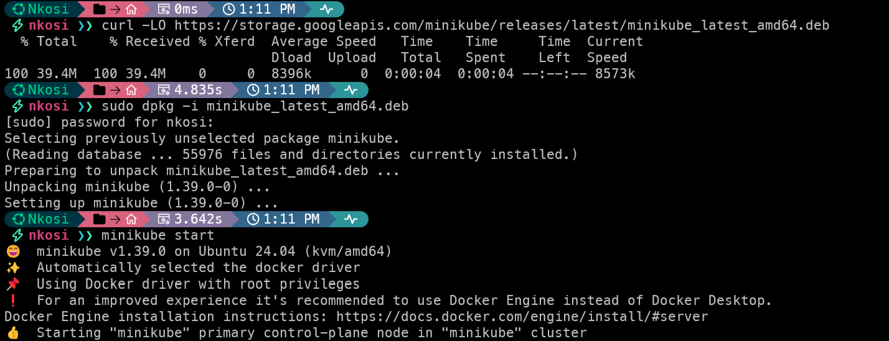
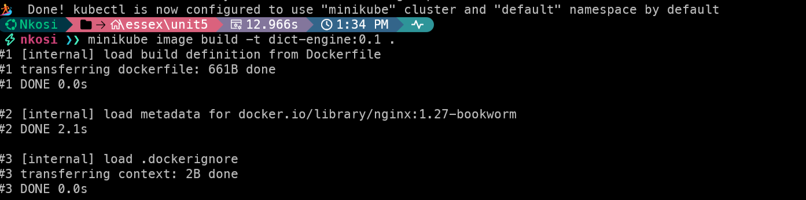
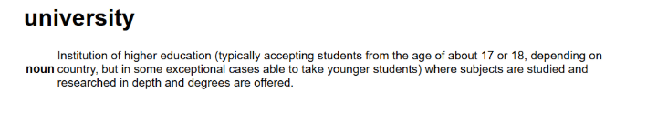
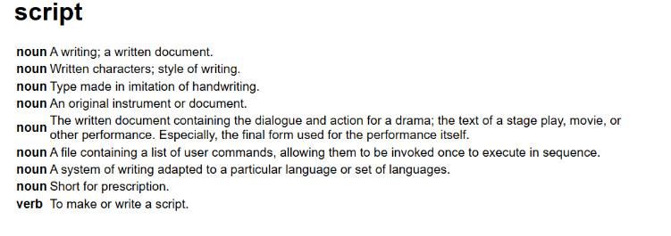
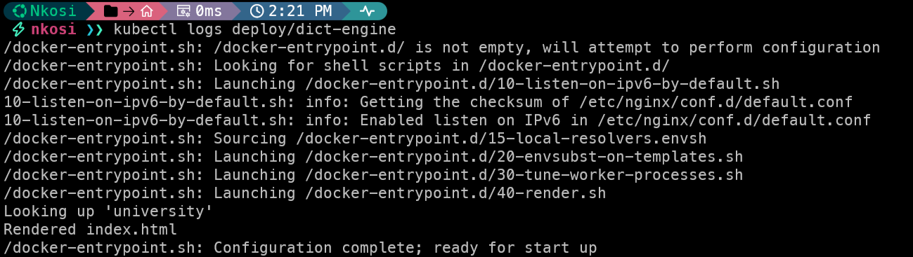
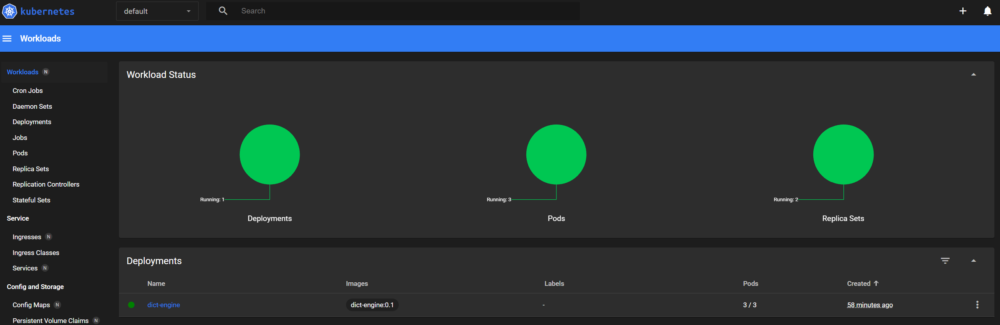

## Kubernetes Cluster Deployment

A step-by-step guide to how I deployed my dictionary app as a 12-Factor app on a local Kubernetes cluster with Minikube. Each step is tagged with the factors it demonstrates, and the summary at the end shows how the app meets all twelve.

<b>Step 1: Install Minikube</b>  

I installed Minikube in Windows Subsystem for Linux (WSL). This is a personal preference: I have found Docker performs much better in WSL than on Windows directly. Docker must already be installed in WSL, because Minikube uses it to run the cluster.
I used the Debian package from the Minikube documentation, then started the minikube cluster :

```bash
curl -LO https://storage.googleapis.com/minikube/releases/latest/minikube_latest_amd64.deb
sudo dpkg -i minikube_latest_amd64.deb

minikube start
```


<b>Step 2: Codebase and Dockerfile</b>    
<i>Factors: I. Codebase, II. Dependencies</i>

I converted my Bash script from Unit 4 into a Dockerfile, which is my 12-Factor app. It is a simple service that, given a word, uses the Free Dictionary API to return its definition.
The codebase is tracked in a single Git repository: . It consists of two files in the same folder:

```
dict-engine/
    Dockerfile
    k8s.yaml
```
Every dependency (curl and the DuckDB CLI) is declared and installed in the Dockerfile at build time, so nothing is installed when the container starts. The render script and the SQL are written into the image with heredocs (Panovski, 2026). The base image uses the nginx:stable tag, which is convenient but moves with each new stable release; pinning a specific version would make builds fully reproducible.

```bash
# syntax=docker/dockerfile:1
FROM nginx:stable

# Install curl and the DuckDB CLI at build time
RUN apt-get update && apt-get install -y --no-install-recommends curl ca-certificates \
 && rm -rf /var/lib/apt/lists/* \
 && curl -fsSL -o /tmp/duckdb.tgz \
      "https://github.com/duckdb/duckdb/releases/download/v2.0.0/duckdb-cli-linux-$(dpkg --print-architecture).tar.gz" \
 && tar -xzf /tmp/duckdb.tgz -C /usr/local/bin duckdb \
 && rm /tmp/duckdb.tgz

# SQL that turns the API response into HTML
COPY <<'EOF' /opt/render.sql
CREATE MACRO esc(s) AS replace(replace(replace(s, '&', '&amp;'), '<', '&lt;'), '>', '&gt;');

CREATE TABLE meanings AS
SELECT word, unnest(meanings) AS m FROM read_json_auto('/tmp/word.json');

SELECT '<!DOCTYPE html><html><head><meta charset="UTF-8"><title>' || esc(word) || '</title></head>'
    || '<body style="font-family:sans-serif;max-width:800px;margin:40px auto">'
    || '<h1>' || esc(word) || '</h1><table>'
FROM meanings LIMIT 1;

SELECT '<tr><td><b>' || esc(m.partOfSpeech) || '</b></td><td>' || esc(unnest(m.definitions).definition) || '</td></tr>'
FROM meanings;

SELECT '</table></body></html>';
EOF

# Startup script: scripts in /docker-entrypoint.d/ run before Nginx starts
COPY --chmod=755 <<'EOF' /docker-entrypoint.d/40-render.sh
#!/usr/bin/env bash
set -euo pipefail

: "${WORD:?WORD must be set}"
API_URL="${DICTIONARY_API_URL:-https://api.dictionaryapi.dev/api/v2/entries/en}"

echo "Looking up '$WORD'"
curl -fsS --retry 3 -o /tmp/word.json "$API_URL/$WORD"
duckdb -bail -noheader -list < /opt/render.sql > /usr/share/nginx/html/index.html
echo "Rendered index.html"
EOF
```


<b>Step 3: Kubernetes config</b>  
<i>Factors: III. Config, VII. Port binding</i>

k8s.yaml defines three resources. The ConfigMap holds the word to look up, so configuration lives outside the code. The Deployment runs the image and loads the ConfigMap as environment variables. The Service exposes the app's port 80 outside the cluster.

```yaml
# Config: the word to look up
apiVersion: v1
kind: ConfigMap
metadata:
  name: dict-engine-config
data:
  WORD: university
---
# Runs the container built in step 4
apiVersion: apps/v1
kind: Deployment
metadata:
  name: dict-engine
spec:
  replicas: 1
  selector:
    matchLabels:
      app: dict-engine
  template:
    metadata:
      labels:
        app: dict-engine
    spec:
      containers:
        - name: dict-engine
          image: dict-engine:0.1
          imagePullPolicy: IfNotPresent   # use the image built inside minikube
          envFrom:
            - configMapRef:
                name: dict-engine-config
          ports:
            - containerPort: 80
---
# Exposes the pods on a port of the minikube node
apiVersion: v1
kind: Service
metadata:
  name: dict-engine
spec:
  type: NodePort
  selector:
    app: dict-engine
  ports:
    - port: 80
      targetPort: 80
```

<b>Step 4: Build the image</b>  
<i>Factors: II. Dependencies, V. Build, release, run</i>

From inside the dict-engine/ folder, I built the image directly in the Minikube cluster, so Kubernetes can use it without a registry. The tag must match the image: line in k8s.yaml.

```
minikube image build -t dict-engine:0.1 .
```



<b>Step 5: Deploy and access the app</b>
<i>Factors: VII. Port binding</i>

Applying the config file creates the ConfigMap, Deployment and Service in one command. Once the pod is running, Minikube gives me a URL for the Service.

```
kubectl apply -f k8s.yaml
kubectl get pods
minikube service dict-engine --url
```

*Browser Output*
  


<b>Step 6: Change the word</b>  
<i>Factors: III. Config, V. Build, release, run</i>

The word lives only in the ConfigMap, so changing it needs no rebuild. I edit `WORD` in k8s.yaml, apply it, then restart the pods so they render the new page.

```
kubectl apply -f k8s.yaml
kubectl rollout restart deployment/dict-engine
```

*Browser Output*
  


<b>Step 7: Logs</b>  
<i>Factors: XI. Logs</i>

The app writes its logs to stdout, so Kubernetes collects them with no log files inside the container.

```
kubectl logs deploy/dict-engine
```


<b>Step 8: Scale and replace pods</b>  
<i>Factors: VIII. Concurrency, IX. Disposability</i>

I scaled the app to three replicas, then deleted one pod. Kubernetes replaced it within seconds, because each pod is stateless and starts quickly.

```
kubectl scale deployment/dict-engine --replicas=3
kubectl delete pod dict-engine-bff8f5568-npf8g
kubectl get pods
```
Minikube Dashboard


## Summary: how the app meets the twelve factors

| Factor | How the app meets it |
| --- | --- |
| I. Codebase | One Git repository holding the Dockerfile and `k8s.yaml` |
| II. Dependencies | curl and DuckDB declared and installed in the Dockerfile |
| III. Config | `WORD` stored in a ConfigMap, injected as an environment variable |
| IV. Backing services | The dictionary API is an attached resource; `DICTIONARY_API_URL` can point elsewhere without code changes |
| V. Build, release, run | Image built once, released with its config, run by the Deployment |
| VI. Processes | Pods are stateless; each renders its page on start and stores nothing |
| VII. Port binding | Nginx serves on port 80, exposed by a NodePort Service |
| VIII. Concurrency | Scaled out by adding replicas |
| IX. Disposability | Pods start in seconds and are replaced automatically |
| X. Dev/prod parity | The same image runs in Minikube or any other cluster |
| XI. Logs | Written to stdout and read with `kubectl logs` |
| XII. Admin processes | One-off tasks run in a pod, e.g. `kubectl exec deploy/dict-engine -- cat /tmp/word.json` |


**References**

Kubernetes (2026) minikube start. Available at: https://minikube.sigs.k8s.io/docs/start/ (Accessed: 31 October 2026).  

Panovski, D. (2026) Bash Heredoc: Complete Guide with Examples. Available at: https://linuxize.com/post/bash-heredoc/ (Accessed: 31 October 2026).  

Wiggins, A. (2011) The Twelve-Factor App. Available at: https://12factor.net/ (Accessed: 31 October 2026).

