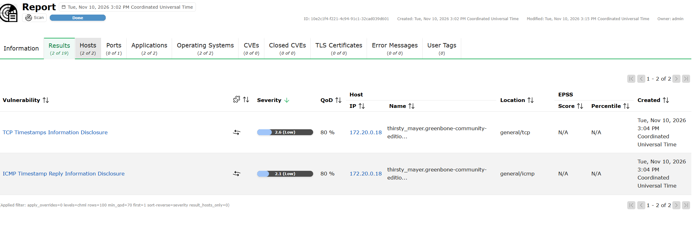
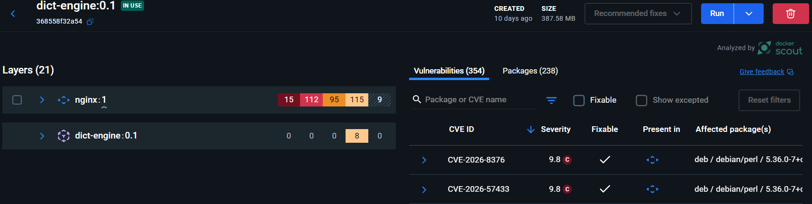
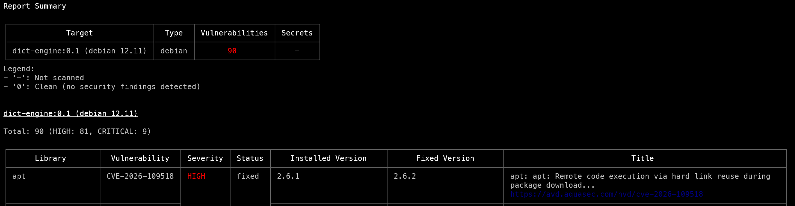

## Security Audit of a Docker-Based Dictionary API

## Scanning Tools and Results

I used three tools to scan my docker image and its container for vulnerabilities and misconfigurations:

Greenbone Community Edition (OpenVAS) was used to scan the running container for network-exposed vulnerabilities.




Docker Scout and Trivy were used to scan the image for package vulnerabilities. Docker Scout is a free tool from Docker that scans images for known vulnerabilities, while Trivy is an open-source vulnerability scanner that can scan container images, file systems and Git repositories.





## 1. Architecture and scope

The audited system is my dictionary API application (image: `dict-engine:0.1`) from Unit 5. 
It ran on Docker under WSL2 alongside the OpenVAS scanner, on the following IP addresses 172.17.0.2 and 172.20.0.18. The scope covered network-exposed services, image contents and container configuration. Source code review, authenticated scanning and cloud controls were excluded. 


## 2. Method

Greenbone Community Edition (OpenVAS) was deployed from its official container images rather than via a virtual machine. 

```zsh
export DOWNLOAD_DIR=$HOME/greenbone-community-container && mkdir -p $DOWNLOAD_DIR
cd $DOWNLOAD_DIR
curl -f -O https://greenbone.github.io/docs/latest/_static/setup-and-start-greenbone-community-edition.sh
chmod u+x setup-and-start-greenbone-community-edition.sh
./setup-and-start-greenbone-community-edition.sh
```

Once all containers were running, an unauthenticated scan was run with the “Full and fast” configuration, the “All IANA assigned TCP” port list and a “Consider Alive” test. As network scanning cannot inspect image contents, Trivy and Docker Scout were used to analyse the image’s packages.


## 3. Findings, severity and impact

**Summary of findings.**

| Finding | Tool | Severity | Potential impact |
| --- | --- | --- | --- |
| TCP timestamps disclosure | OpenVAS | Low (2.6) | Reveals uptime, aiding host fingerprinting |
| ICMP timestamp reply disclosure | OpenVAS | Low (2.1) | Reveals the host clock |
| Outdated packages in the image | Docker Scout, Trivy | 15 Critical, 112 High | Code execution or denial of service via OpenSSL, XML, Perl and codec libraries |

Docker Scout found 354 vulnerabilities, 346 of them inherited from `nginx:1`. The application’s own layers added only eight Low-severity issues. All 90 High and Critical issues reported by Trivy have fixes available. Counts differ between the tools because they draw on different rating sources, and many affected packages are unused by the API, so practical exploitability is lower than the totals suggest.

## 4. Mitigation and ISO/IEC 27001 alignment

**Recommended controls mapped to ISO/IEC 27001:2022 Annex A.**

| Control | Annex A |
| --- | --- |
| Rebuild on a current minimal base (e.g. `nginx:alpine`), pin by digest and scan in CI | 8.8, 8.25, 8.32 |
| Disable TCP timestamps; block ICMP timestamps at the firewall | 8.20, 8.9 |
| Run as non-root, drop capabilities, use a read-only filesystem | 8.2, 8.9 |
| Segment networks and publish only required ports | 8.22 |
| Add HTTP security headers and TLS | 8.26, 8.24 |
| Centralise logs and schedule recurring scans | 8.15, 8.16 |

## 5. Limitations and future improvements

The scan was on a local test environment using a simple docker setup without too much complexity. This limited the scope of the analysis. Results were filtered (Trivy limited to High and Critical), and no dynamic application testing was performed. In future audits, the addition of authenticated scanning, Docker Bench for Security against the CIS Docker Benchmark, OWASP ZAP testing and automated image scanning in the build pipeline would provide a more comprehensive assessment.

## 6. Conclusion

Network exposure was minimal, the material risk lies in the outdated `nginx` image, which can be largely remediated by rebuilding on a new image that is up-to-date and secure.

## Bibliography

- Advisera (n.d.) *Big guide to ISO 27001 clauses — How is this standard structured?*. Available at: https://advisera.com/iso27001/technological-controls/ (Accessed: 10 November 2026).
- Aqua Security (n.d.) *Container image – Trivy documentation*. Available at: https://trivy.dev/docs/latest/guide/target/container_image/ (Accessed: 10 November 2026).
- GetCyber (2022) *Complete Beginner OpenVAS Vulnerability Scanning Tutorial - Cyber Security // Kali Linux*. Available at: https://www.youtube.com/watch?v=LGh2SetiKaY (Accessed: 10 November 2026).
- ZAP Dev Team (2026) *ZAP – Getting started*. Available at: https://www.zaproxy.org/getting-started/ (Accessed: 10 November 2026).